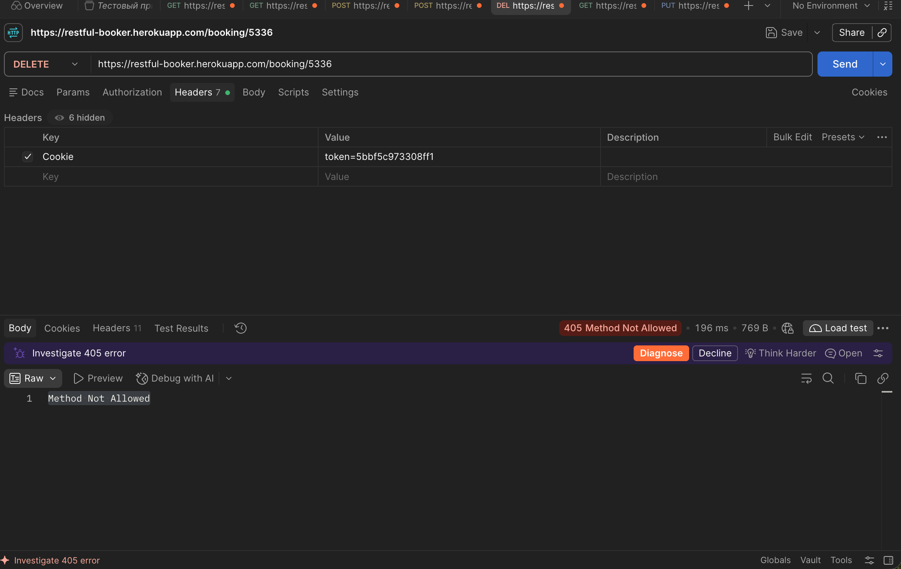

# Баг-репорты: Restful Booker API

**Объект:** https://restful-booker.herokuapp.com — учебный API бронирования отелей
**Окружение:** Postman (desktop), macOS; проверено также автотестами Playwright
**Документация API:** https://restful-booker.herokuapp.com/apidoc/index.html

Серьёзность: Blocker · Critical · Major · Minor · Trivial
Приоритет: High · Medium · Low

---

## BUG-01. DELETE /booking/{id} возвращает 201 Created вместо 200 OK / 204 No Content

**Серьёзность:** Minor
**Приоритет:** Low

**Предусловия:**
1. Создано бронирование (`POST /booking`), известен его `bookingid`
2. Получен токен (`POST /auth` с логином `admin` / `password123`)

**Шаги воспроизведения:**
1. Отправить запрос `DELETE https://restful-booker.herokuapp.com/booking/{bookingid}`
2. В заголовках указать `Cookie: token={токен}`
3. Посмотреть код ответа

**Ожидаемый результат:**
Код ответа `200 OK` или `204 No Content` — стандартные коды HTTP для успешного удаления.

**Фактический результат:**
Код ответа `201 Created`. Бронирование при этом действительно удаляется: повторный `GET /booking/{bookingid}` возвращает `404 Not Found`.

**Почему это важно:**
`201 Created` по стандарту HTTP означает «создан новый ресурс». Клиенты API, которые проверяют коды ответа по стандарту, могут неправильно обработать результат удаления.

**Вложения:** скриншот из Postman — *(добавить)*

---

## BUG-02. Повторный DELETE /booking/{id} возвращает 405 вместо 404

**Серьёзность:** Minor
**Приоритет:** Low

**Предусловия:**
1. Создано бронирование (`POST /booking`), известен его `bookingid`
2. Получен токен (`POST /auth`)
3. Бронирование уже удалено (первый `DELETE` вернул 201)

**Шаги воспроизведения:**
1. Отправить запрос `DELETE https://restful-booker.herokuapp.com/booking/{bookingid}` с заголовком `Cookie: token={токен}`
2. Ещё раз отправить DELETE с тем же `bookingid`
3. Посмотреть код ответа

**Ожидаемый результат:**
Код ответа 404 Not Found — бронирования с таким номером не существует.

**Фактический результат:**
Код ответа 405 Method Not Allowed. Этот код означает, что метод DELETE запрещён, хотя на самом деле он разрешён — бронирования просто нет.

**Вложения:** 