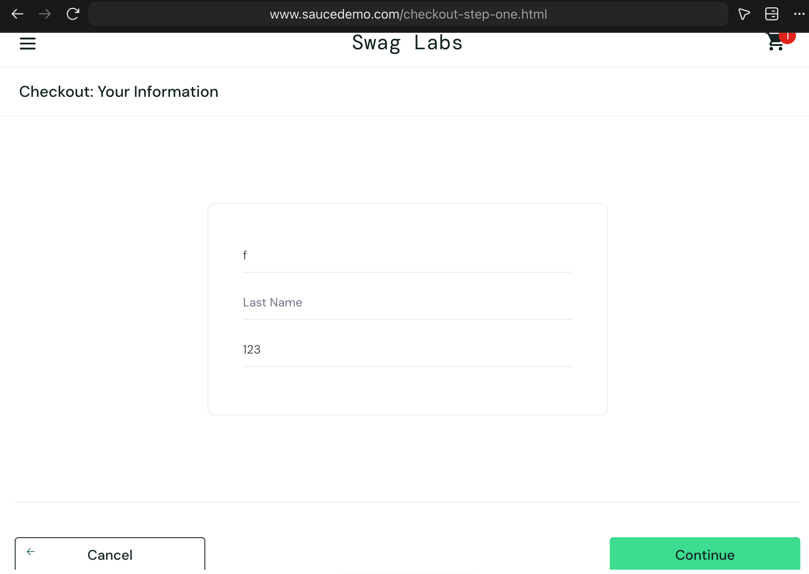

# Баг-репорты: saucedemo.com

**Объект:** https://www.saucedemo.com — учебный интернет-магазин
**Окружение:** Google Chrome (последняя версия), macOS
**Пароль для всех пользователей:** `secret_sauce`

Серьёзность: Blocker · Critical · Major · Minor · Trivial
Приоритет: High · Medium · Low

---

## BUG-01. Checkout: при вводе в поле Last Name текст попадает в поле First Name и удаляет его

**Серьёзность:** Blocker
**Приоритет:** High
**Пользователь:** `problem_user`

**Предусловия:**
1. Выполнен вход под `problem_user`
2. В корзине есть товар

**Шаги воспроизведения:**
1. Открыть корзину
2. Нажать на Checkout
3. Ввести в поле First Name: `Maria`
4. Перейти в поле Last Name и ввести: `Test`

**Ожидаемый результат:**
Текст `Test` появляется в поле Last Name, поле First Name не меняется. После нажатия Continue открывается страница Checkout: Overview.

**Фактический результат:**
Буквы попадают в поле First Name и заменяют имя: в нём остаётся только одна буква. Поле Last Name остаётся пустым. При нажатии Continue появляется ошибка `Error: Last Name is required`. Оформить заказ невозможно.

**Вложения:** 
