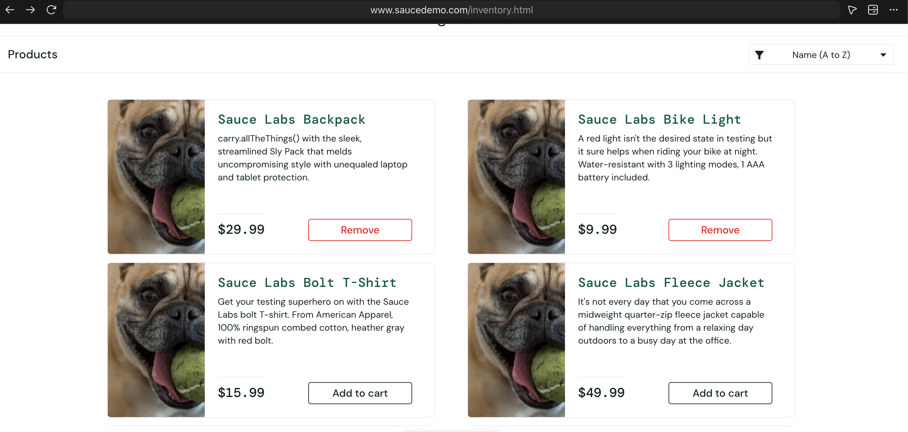
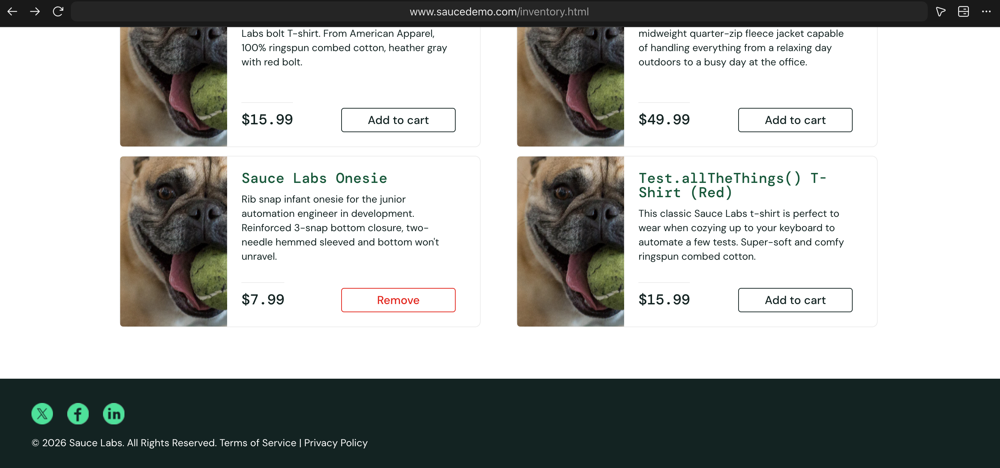
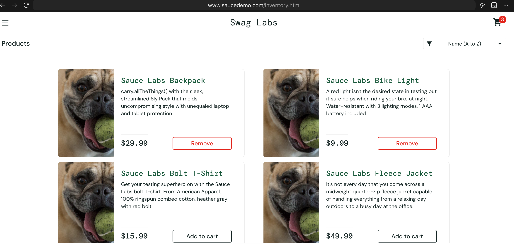
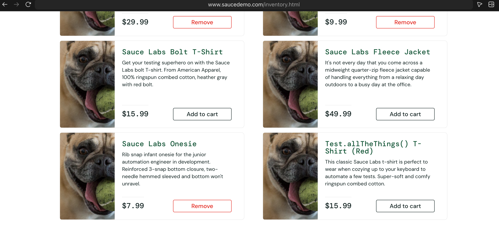
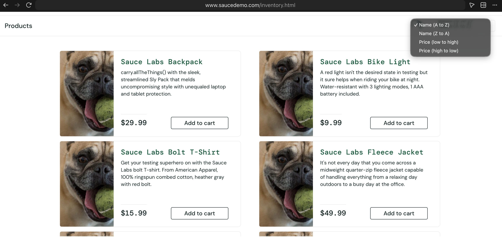
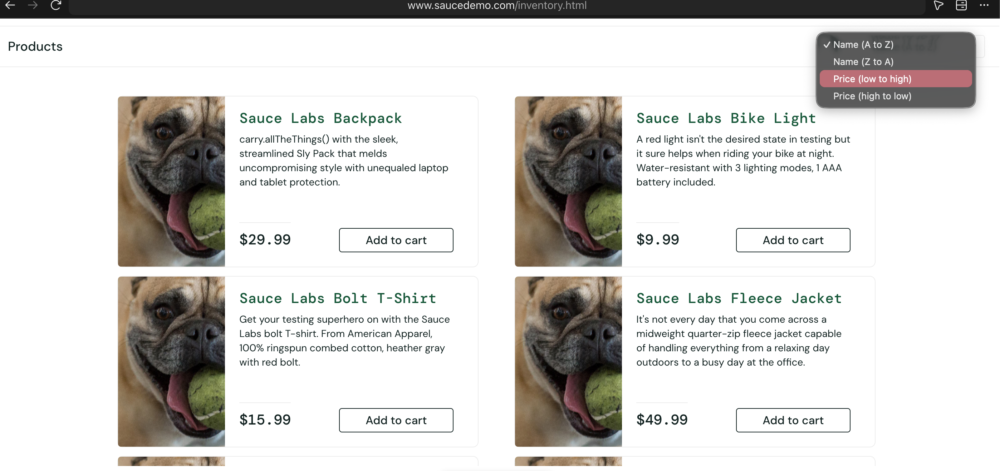
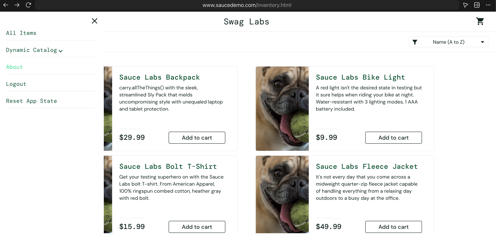
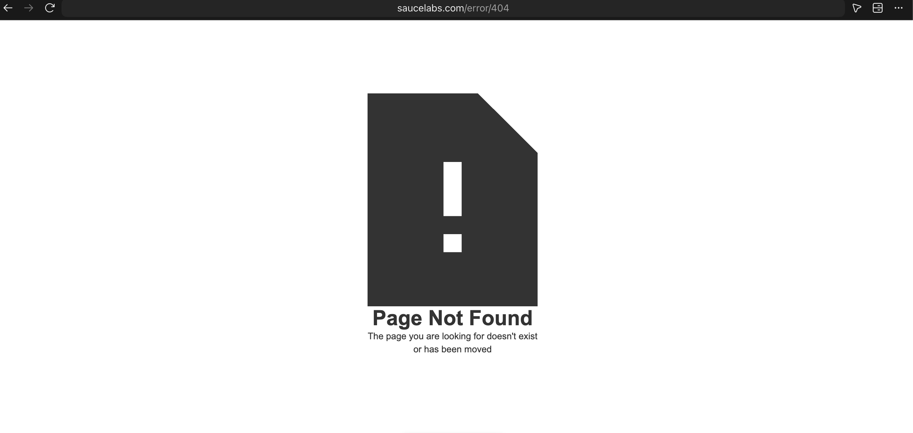

# Баг-репорты: saucedemo.com

**Объект:** https://www.saucedemo.com — учебный интернет-магазин
**Окружение:** Google Chrome (последняя версия), macOS
**Пароль для всех пользователей:** `secret_sauce`

Серьёзность: Blocker · Critical · Major · Minor · Trivial
Приоритет: High · Medium · Low

---

## BUG-01. Checkout: при вводе в поле Last Name текст попадает в поле First Name и удаляет его

**Серьёзность:** Blocker
**Приоритет:** High
**Пользователь:** `problem_user`

**Предусловия:**
1. Выполнен вход под `problem_user`
2. В корзине есть товар

**Шаги воспроизведения:**
1. Открыть корзину
2. Нажать на Checkout
3. Ввести в поле First Name: `Maria`
4. Перейти в поле Last Name и ввести: `Test`

**Ожидаемый результат:**
Текст `Test` появляется в поле Last Name, поле First Name не меняется. После нажатия Continue открывается страница Checkout: Overview.

**Фактический результат:**
Буквы попадают в поле First Name и заменяют имя: в нём остаётся только одна буква. Поле Last Name остаётся пустым. При нажатии Continue появляется ошибка `Error: Last Name is required`. Оформить заказ невозможно.

**Вложения:** 

---

## BUG-02. Products: при нажатии на товар открывается страница другого товара
**Серьёзность:** Critical
**Приоритет:** High
**Пользователь:** `problem_user`

**Предусловия:**
1. Выполнен вход под `problem_user`

**Шаги воспроизведения:**
1. Открыть каталог
2. Нажать на товар Sauce Labs Backpack $29.99
3. Посмотреть название и цену на открывшейся странице 

**Ожидаемый результат:**
Открывается страница Sauce Labs Backpack с ценой $29.99. 

**Фактический результат:**
При нажатии на товар Sauce Labs Backpack $29.99, открывается другой товар Sauce Labs Fleece Jacket $49.99. 
Воспроизводится для всех товаров каталога (проверено 6 из 6):

| Нажала в каталоге | Открылось на странице товара |
|---|---|
| Sauce Labs Backpack ($29.99) | Sauce Labs Fleece Jacket ($49.99) |
| Sauce Labs Bike Light ($9.99) | Sauce Labs Bolt T-Shirt ($15.99) |
| Sauce Labs Bolt T-Shirt ($15.99) | Sauce Labs Onesie ($7.99) |
| Sauce Labs Fleece Jacket ($49.99) | страница «ITEM NOT FOUND» — товар не найден |
| Sauce Labs Onesie ($7.99) | Test.allTheThings() T-Shirt (Red) ($15.99) |
| Test.allTheThings() T-Shirt (Red) ($15.99) | Sauce Labs Backpack ($29.99) |

**Вложения:** 

---

## BUG-03. Products: в каталоге у трех товаров кнопка Add to cart не работает: товар не попадает в корзину 

**Серьёзность:** Critical
**Приоритет:** High
**Пользователь:** `problem_user`

**Предусловия:**
1. Выполнен вход под `problem_user`

**Шаги воспроизведения:**
1. Открыть каталог
2. Нажать на Add to cart у всех шести товаров
3. Открыть корзину

**Ожидаемый результат:**
Все 6 товаров добавятся в корзину, у всех кнопка сменится на Remove, на значке корзины будет 6.

**Фактический результат:**
- У Sauce Labs Backpack, Sauce Labs Bike Light, Sauce Labs Onesie кнопка сменилась на Remove, они в корзине;
- У Sauce Labs Bolt T-Shirt, Sauce Labs Fleece Jacket, Test.allTheThings() T-Shirt (Red) кнопка осталась Add to cart, в корзину они не попали;
- В корзине только 3 товара;
- У `standard_user` все 6 добавляются нормально.

**Вложения:** 

---

## BUG-04. Products: в каталоге и на странице товара не работает кнопка Remove

**Серьёзность:** Major
**Приоритет:** High 
**Пользователь:** `problem_user`

**Предусловия:**
1. Выполнен вход под `problem_user`
2. Из каталога в корзину добавлены Sauce Labs Backpack, Sauce Labs Bike Light, Sauce Labs Onesie

**Шаги воспроизведения:**
1. Открыть каталог
2. Нажать на Remove у Sauce Labs Backpack, Sauce Labs Bike Light, Sauce Labs Onesie
3. Открыть корзину

**Ожидаемый результат:**
Все 3 товара удаляются из корзины, у всех кнопка сменится на Add to cart, значка на корзине не будет.

**Фактический результат:**
- У Sauce Labs Backpack, Sauce Labs Bike Light, Sauce Labs Onesie кнопка не сменилась на Add to cart, они все еще в корзине, на самой странице товаров кнопка Remove также не работает;
- Из корзины все 3 товара удаляются;
- У `standard_user` Remove в каталоге работает, товары удаляются.

**Вложения:** 

---

## BUG-05. Products: выбранный вариант сортировки не применяется, товары остаются в порядке Name (A to Z)

**Серьёзность:** Minor
**Приоритет:** Low
**Пользователь:** `problem_user`

**Предусловия:**
1. Выполнен вход под `problem_user`

**Шаги воспроизведения:**
1. Открыть каталог
2. Нажать на список сортировки (справа вверху)
3. Выбрать Price (low to high)
4. Посмотреть, какой вариант отмечен галочкой и в каком порядке идут цены

**Ожидаемый результат:**
Галочка стоит на Price (low to high), товары отсортированы по возрастанию цены: от $7.99 до $49.99. 

**Фактический результат:**
Вариант можно выбрать, но выбор не применяется: галочка остаётся на Name (A to Z), порядок товаров не меняется ($29.99, $9.99, $15.99, $49.99…).

Проверены все варианты сортировки:

| Вариант | Галочка | Порядок товаров |
|---|---|---|
| Name (A to Z) | ✅ стоит (по умолчанию) | по алфавиту (так и было) |
| Name (Z to A) | ❌ остаётся на Name (A to Z) | не меняется |
| Price (low to high) | ❌ остаётся на Name (A to Z) | не меняется |
| Price (high to low) | ❌ остаётся на Name (A to Z) | не меняется |

У `standard_user` все варианты сортировки работают.

**Вложения:** 

---

## BUG-06. Menu: пункт About открывает страницу 404 вместо сайта Sauce Labs

**Серьёзность:** Minor
**Приоритет:** Low
**Пользователь:** `problem_user`

**Предусловия:**
1. Выполнен вход под `problem_user`

**Шаги воспроизведения:**
1. Открыть каталог
2. Нажать на меню слева сверху
3. Нажать на кнопку About

**Ожидаемый результат:**
При открытии меню и нажатии на кнопку About открывается главная страница сайта Sauce Labs (https://saucelabs.com/).

**Фактический результат:**
- При нажатии в меню на кнопку About открывается страница с Page Not Found (https://saucelabs.com/error/404);
- У `standard_user` About открывает https://saucelabs.com/.

**Вложения:** 

